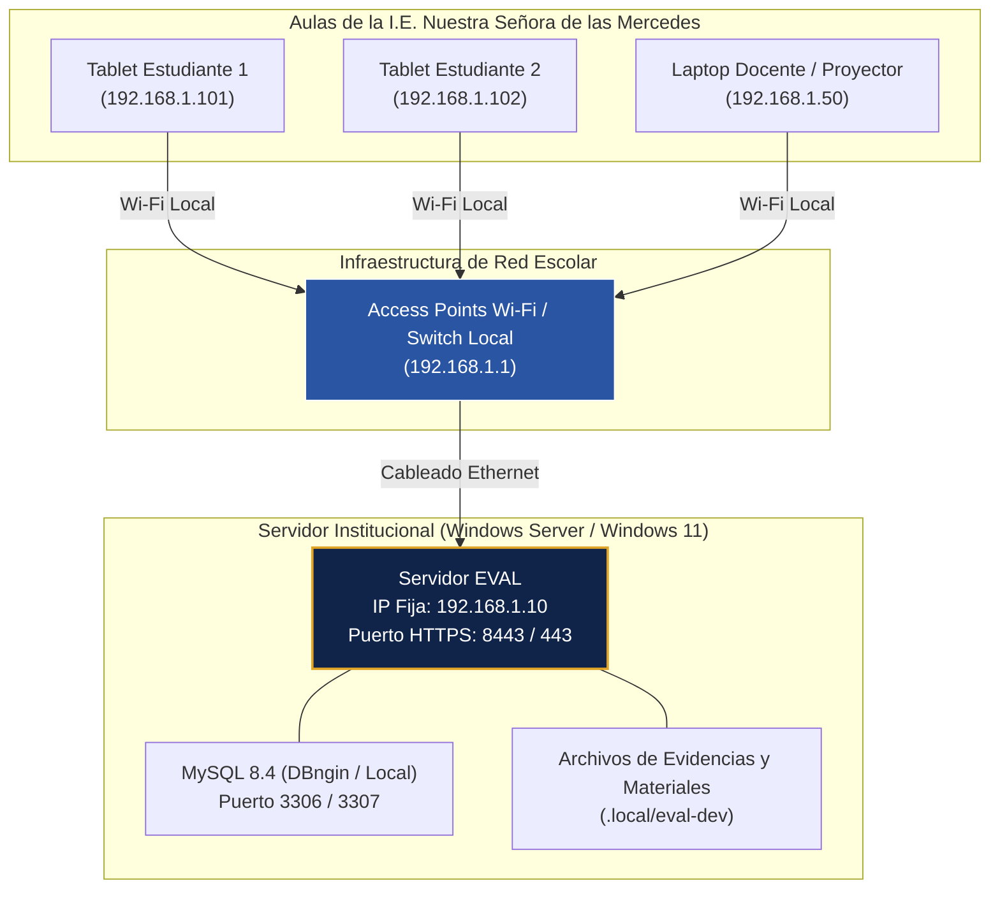

# Guía de Despliegue en Red Local (LAN/WLAN) y Windows Server

**Plataforma:** EVAL — Plataforma Educativa Institucional  
**Institución:** I.E. Nuestra Señora de las Mercedes (Ayacucho, Perú)  
**Versión:** 2.1  
**Fecha:** 2026-10-15  

---

## 1. Arquitectura de Red Institucional Offline

EVAL está concebido como una plataforma educativa **híbrida y local**. Su principio fundamental es:
> **Los estudiantes y docentes deben poder acceder a las aulas, materiales, tareas y evaluaciones dentro del colegio a través de la red local (LAN cableada o Wi-Fi institucional), incluso si se corta el suministro de Internet externo.**



---

## 2. Requisitos Previos del Servidor

1. **Sistema Operativo:** Windows Server 2022 / 2019 o Windows 11 Pro de 64 bits.
2. **Dirección IP Estática (Recomendado):** Asignar una IP fija al servidor en la interfaz de red Ethernet (ejemplo: `192.168.1.10` con máscara `255.255.255.0`).
3. **Servicios Necesarios:**
   - PHP 8.4 (con extensiones `mbstring`, `intl`, `pdo_mysql`, `openssl`).
   - Motor MySQL 8.4 (DBngin o servicio local independiente).
   - Node.js LTS (v22 o v24).
4. **Almacenamiento:** Disco SSD con al menos 20 GB de espacio libre para archivos PDF, imágenes y base de datos.

---

## 3. Configuración del Firewall de Windows

Para que las computadoras, laptops y tablets de las aulas puedan conectarse al servidor, se debe abrir el puerto HTTPS (por defecto `8443` o `443` en producción):

### Comando PowerShell (Ejecutar como Administrador):
```powershell
New-NetFirewallRule -Name "EVAL_HTTPS_LAN" `
    -DisplayName "EVAL Plataforma Educativa (HTTPS LAN)" `
    -Direction Inbound `
    -LocalPort 8443 `
    -Protocol TCP `
    -Action Allow `
    -Profile Domain,Private
```

> [!CAUTION]  
> **Nunca abrir el puerto de MySQL (3306 o 3307) en el Firewall.** La base de datos debe ser accesible exclusivamente de forma interna en `127.0.0.1` desde el propio servidor.

---

## 4. Certificado TLS Institucional y Nombres de Dominio

Los navegadores modernos en tablets y móviles exigen HTTPS seguro para permitir almacenamiento en caché,Service Workers y contraseñas.

### 4.1 Generación de Certificado Multi-SAN para la LAN
El certificado debe incluir tanto `127.0.0.1` como la IP del servidor en la red del colegio:

```powershell
powershell -ExecutionPolicy Bypass -File .\backend\scripts\setup-lan.ps1
```

Este script detecta automáticamente la IP LAN de la máquina (por ejemplo `192.168.1.10`), regenera el archivo `cert.pem` y `key.pem` con los Nombres Alternativos del Sujeto (SAN):
- `IP:127.0.0.1`
- `IP:192.168.1.10`
- `DNS:eval.mercedes.local`
- `DNS:localhost`

### 4.2 Instalación del Certificado Raíz en las Tablets del Colegio
Para que las tablets no muestren advertencia de *"Sitio no seguro"*:
1. Exportar `cert.pem` a una memoria USB o compartirlo en la red como `eval-ca.crt`.
2. En cada tablet Android / Windows del colegio:
   - Ir a *Ajustes* → *Seguridad* → *Instalar certificados* (o *Gestión de certificados*).
   - Seleccionar `eval-ca.crt` y asignarlo como "Certificado de CA para Wi-Fi o aplicaciones".
   - A partir de ese momento, la conexión a `https://192.168.1.10:8443` mostrará el candado verde/seguro institucional sin avisos.

---

## 5. Acceso de Usuarios desde las Aulas

| Dispositivo / Rol | URL de Acceso | Casos de Uso |
|---|---|---|
| **Tablets de Estudiantes** | `https://192.168.1.10:8443` | Descarga de guías, resolución de tareas, subida de fotos/PDFs de tareas, consulta de notas AD/A/B/C. |
| **Laptops de Docentes** | `https://192.168.1.10:8443` | Publicación de actividades semanales, registro de calificaciones cualitativas, retroalimentación. |
| **Proyectores / Pantalla de Aula** | `https://192.168.1.10:8443` | Modo presentación sin distracciones para proyectar PDFs y esquemas en clase. |
| **Dirección / Subdirección** | `https://192.168.1.10:8443` | Reportes de aula, gestión de bimestres, calendarios y cuentas. |

---

## 6. Prueba de Resiliencia: Operación Sin Internet Externo

Para certificar que el colegio puede funcionar durante un corte general de Internet en Ayacucho:

1. **Procedimiento del Simulacro:**
   - Desconectar el cable del módem/proveedor de Internet (WAN) que entra al router del colegio.
   - Mantener encendidos el switch local, los access points Wi-Fi y el servidor EVAL.
2. **Verificaciones a Realizar:**
   - Conectar una tablet al Wi-Fi del colegio.
   - Navegar a `https://192.168.1.10:8443`.
   - Comprobar que:
     - El login carga de inmediato (sin dependencias a CDNs externos; fuentes Fraunces e Inter e iconos están empaquetados localmente en `dist/assets/`).
     - El estudiante puede subir una tarea de muestra.
     - El docente puede calificarla en tiempo real.
     - La base de datos registra la entrega con el write guard ordinal intacto.

---

## 7. Procedimiento de Actualización de Versión en el Servidor

Cuando el equipo de desarrollo entregue una nueva versión (commit o release):

1. **Crear un backup preventivo:**
   ```powershell
   powershell -ExecutionPolicy Bypass -File .\backend\scripts\backup.ps1
   ```
2. **Detener temporalmente el servicio web:**
   ```powershell
   powershell -ExecutionPolicy Bypass -File .\backend\scripts\manage-dev.ps1 stop
   ```
3. **Descargar los cambios de Git:**
   ```powershell
   git pull origin main
   ```
4. **Reconstruir frontend y ejecutar migraciones:**
   ```powershell
   cd frontend
   npm run build
   cd ..
   ```
5. **Iniciar el servicio nuevamente:**
   ```powershell
   powershell -ExecutionPolicy Bypass -File .\backend\scripts\manage-dev.ps1 start
   ```
6. **Verificar estado:**
   ```powershell
   powershell -ExecutionPolicy Bypass -File .\backend\scripts\manage-dev.ps1 status
   ```
