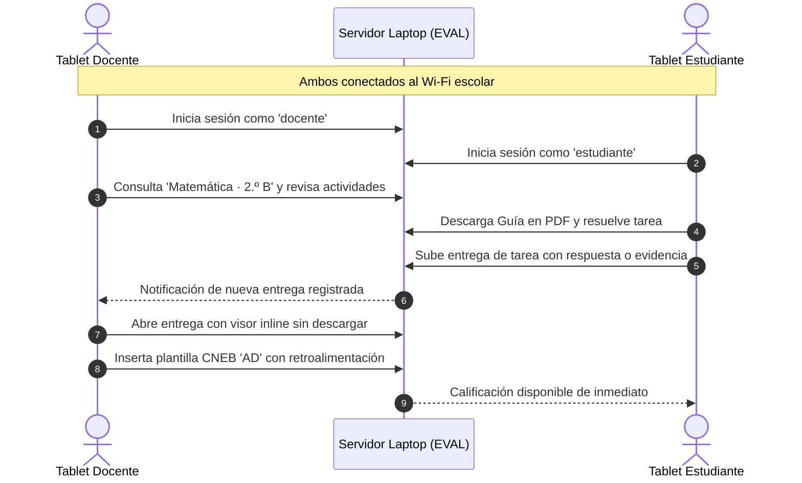

# Manual de Operación: Configuración del Servidor y Conexión de Tablets en Red Wi-Fi

**Plataforma:** EVAL v2.1 — Plataforma Educativa Institucional  
**Institución:** I.E. Nuestra Señora de las Mercedes (Ayacucho, Perú)  
**Modalidad:** Red Local Wi-Fi (Router Común - 100% Offline / Sin Internet)  
**Fecha:** Noviembre 2026  

---

## 1. Resumen de la Arquitectura
En esta modalidad, **tu propia laptop o computadora funciona como el servidor central de EVAL**. 

* **No necesitas conexión a Internet:** El router Wi-Fi del colegio o de tu casa actúa únicamente como puente local entre los dispositivos.
* **No necesitas instalar programas en las tablets:** Funcionan con su navegador estándar (Google Chrome, Samsung Internet o Edge).
* **Multi-hilo concurrente:** El servidor está optimizado con 8 procesos trabajadores en paralelo para atender a múltiples tablets simultáneamente sin encolar ni demorar las peticiones.

```
       [ Router Wi-Fi Común (Sin Internet obligatorio) ]
                         ▲
                         │
     ┌───────────────────┼───────────────────┐
     │                   │                   │
[ Tablet Docente ]   [ Tablet Alumno ]   [ Laptop Servidor EVAL ]
  192.168.0.x         192.168.0.x         192.168.0.101:8443
```

---

## 2. Preparación de la Laptop (Servidor)

### Paso 2.1: Asegurar que la Red Wi-Fi sea "Privada"
Windows bloquea por seguridad el tráfico entrante en redes marcadas como "Públicas".
1. En tu laptop, presiona las teclas `Windows + I` para abrir **Configuración**.
2. Ve a **Red e Internet** → **Wi-Fi**.
3. Haz clic sobre el nombre de tu red Wi-Fi conectada.
4. En **Tipo de perfil de red**, asegúrate de que esté seleccionado **Red privada**.

### Paso 2.2: Habilitar el Firewall en 1 Clic
Para que Windows permita que las tablets se comuniquen con el puerto `8443`:
1. Ubica en la carpeta de EVAL el archivo:
   👉 **`habilitar-firewall-tablets.cmd`**
2. Hazle **doble clic** (o clic derecho → *Ejecutar como administrador*).
3. Aparecerá la ventana de confirmación de Windows (UAC); haz clic en **Sí**.
4. La ventana confirmará con el mensaje:
   `[EXITO] Puerto TCP 8443 abierto correctamente en Windows Firewall.`
5. Presiona cualquier tecla para cerrar la ventana. *(Este paso solo se realiza una vez).*

### Paso 2.3: Iniciar el Servidor de EVAL para Tablets
1. Haz doble clic en el acceso directo principal:
   👉 **`iniciar-eval-tablets.bat`**
2. El script realizará automáticamente:
   * Limpieza de procesos previos.
   * Comprobación de la base de datos MySQL aislada en puerto 3307.
   * Detección de tu dirección IP Wi-Fi real (ej. `192.168.0.101`).
   * Creación del certificado de seguridad SSL amparando tu IP.
   * Inicio del servidor con 8 subprocesos de atención simultánea.
3. Verás en pantalla el **Panel Interactivo** con el enlace de acceso:
   ```text
   ================================================================================
            EVAL v2.1 - MODO TABLET Y RED LOCAL INSTITUCIONAL (LAN / WLAN)
   ================================================================================
     [ENLACES DE ACCESO]
       >>> TABLETS Y DISPOSITIVOS DEL AULA <<<
       https://192.168.0.101:8443
   ```
4. **Deja esta ventana abierta mientras se realicen las pruebas.**

### Paso 2.4: Mostrar el Código QR en Pantalla
Para evitar tener que escribir la dirección IP manualmente en cada tablet:
1. En la consola del servidor, presiona la letra **`W`**, o haz doble clic en:
   👉 **`Ver QR Tablets.cmd`**
2. Se abrirá una ventana en tu navegador mostrando un **Código QR grande** junto con las credenciales oficiales de prueba.

---

## 3. Conexión de las Tablets (Paso a Paso)

### Paso 3.1: Conexión al Wi-Fi
* En cada tablet, ve a *Ajustes* → *Wi-Fi* y conéctala a la **misma red Wi-Fi** donde está conectada la laptop servidora.

### Paso 3.2: Abrir EVAL
Tienes dos opciones en la tablet:
* **Opción Rápida (Cámara):** Abre la app de Cámara o el lector de códigos de la tablet y apunta al Código QR en la pantalla de la laptop. Toca el enlace emergente.
* **Opción Manual (Navegador):** Abre **Google Chrome** en la tablet y escribe exactamente en la barra de direcciones:
  ```text
  https://192.168.0.101:8443
  ```
  *(Reemplaza por la IP que muestre la consola de tu laptop).*

### Paso 3.3: Superar el Aviso de Seguridad SSL (Solo la primera vez)
Como EVAL es un servidor local institucional, su certificado está firmado por el propio colegio y no por una entidad comercial de Internet. El navegador mostrará:
> *"La conexión no es privada"* o *"Advertencia de seguridad"*.

**Cómo continuar en 2 toques:**
1. Toca en el botón o texto que dice **"Configuración avanzada"** (o *"Detalles"*).
2. Toca en el enlace inferior que dice **"Continuar a 192.168.0.101 (no seguro)"** o *"Acceder al sitio"*.
3. ¡Listo! La pantalla de inicio de EVAL cargará de inmediato con el logo institucional.

---

## 4. Credenciales Oficiales de Demostración

| Rol | Usuario | Contraseña | Uso recomendado en la prueba |
|---|---|---|---|
| **Docente** | `docente` | *(Ver en consola o portal QR)* | Tablet para crear tareas, subir guías y calificar con escala CNEB (AD, A, B, C). |
| **Estudiante** | `estudiante` | *(Ver en consola o portal QR)* | Tablet para consultar el curso *Matemática · 2.º B*, descargar guías y entregar tareas. |
| **Director** | `director` | *(Ver en consola o portal QR)* | Laptop o tablet para ver reportes de avance y estadísticas. |
| **Subdirector** | `subdirector` | *(Ver en consola o portal QR)* | Supervisión de materiales y gestión de calendarios. |

---

## 5. Protocolo de Prueba Simultánea (Simulacro Real en Aula)

Para validar que el sistema soporta el trabajo concurrente de aula sin cuellos de botella:



1. **Prueba de Navegación Cruzada:**
   * En la **Tablet 1 (Docente)**, abre *Mis Cursos* → *Matemática · 2.º B* y navega entre semanas.
   * En la **Tablet 2 (Estudiante)**, navega por los materiales al mismo tiempo. Ambas pantallas deben responder con fluidez instantánea.
2. **Prueba de Entrega y Evaluación en Vivo:**
   * En la **Tablet Estudiante**, realiza una entrega de actividad.
   * En la **Tablet Docente**, refresca el panel de entregas: la entrega aparecerá listada.
   * Toca en **Evaluar**, selecciona la plantilla CNEB **AD**, escribe unas palabras formativas y presiona **Guardar evaluación**.
   * En la **Tablet Estudiante**, comprueba que la calificación ya se refleja en su estado académico.

---

## 6. Preguntas Frecuentes y Solución de Problemas

### 1. La tablet dice: "No se puede acceder a este sitio web" (ERR_CONNECTION_TIMED_OUT)
* **Causa A:** Windows Firewall está bloqueando la conexión.  
  *Solución:* Ejecuta [`habilitar-firewall-tablets.cmd`](file:///C:/Users/lenovo%201/Documents/AVAL-2.1/EVAL-2.1/habilitar-firewall-tablets.cmd) con permisos de administrador.
* **Causa B:** La red en la laptop está como "Pública".  
  *Solución:* Ve a la configuración de Wi-Fi de Windows y cámbiala a "Red Privada" (Paso 2.1).
* **Causa C:** La laptop y la tablet no están en la misma red Wi-Fi.  
  *Solución:* Verifica que ambos dispositivos tengan el mismo nombre de red en Ajustes.
* **Causa D:** El router tiene activado "Aislamiento de clientes" (*AP Isolation*).  
  *Solución:* Algunos routers de invitados bloquean la comunicación entre dispositivos conectados. Si esto ocurre, activa la "Zona con cobertura móvil" (Hotspot) de tu propia laptop y conecta las tablets directamente al Wi-Fi de la laptop.

### 2. La IP de la laptop cambió al reiniciar
* Los routers asignan direcciones IP dinámicas por DHCP.
* Si apagas y prendes la laptop o el router, la IP puede cambiar ligeramente (ej. de `192.168.0.101` a `192.168.0.105`).
* **Solución:** Cada vez que inicies [`iniciar-eval-tablets.bat`](file:///C:/Users/lenovo%201/Documents/AVAL-2.1/EVAL-2.1/iniciar-eval-tablets.bat), la consola detectará la nueva IP y actualizará el Código QR de forma 100% automática.

---

## 7. Cómo Detener el Servidor
Cuando concluyan las pruebas de aula:
* En la consola del servidor presiona la tecla **`Q`**, o bien haz doble clic en el archivo:
  👉 **`Detener EVAL.cmd`**
* Todos los procesos web se cerrarán de forma segura. La base de datos, entregas y notas quedarán intactas y preservadas para la siguiente sesión.
